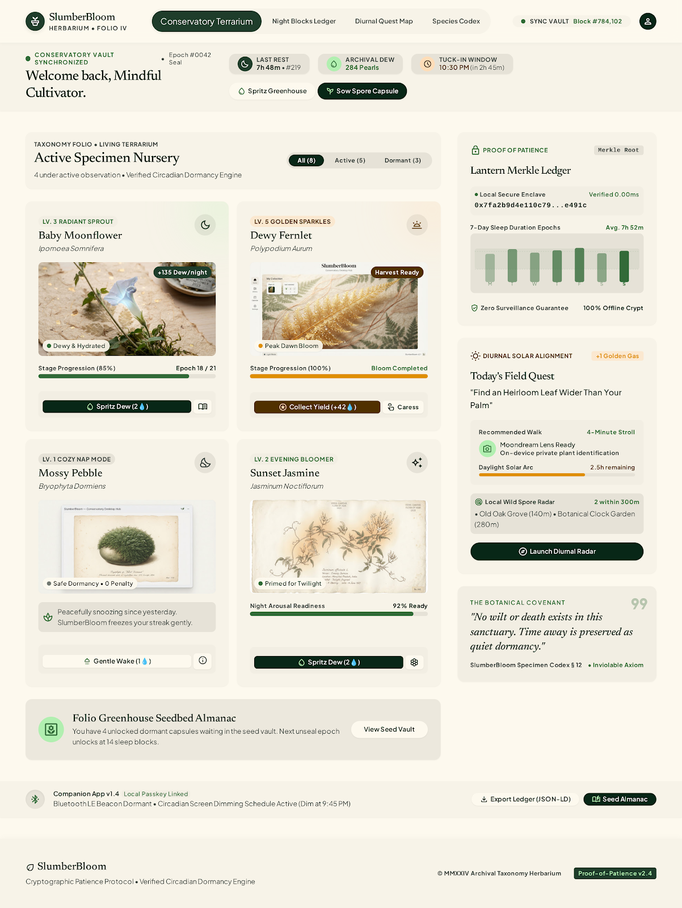
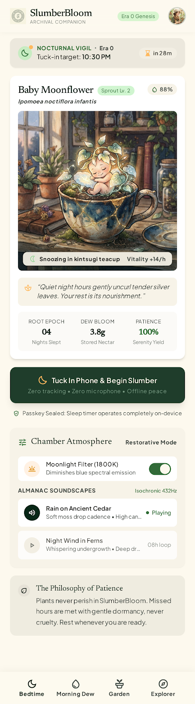
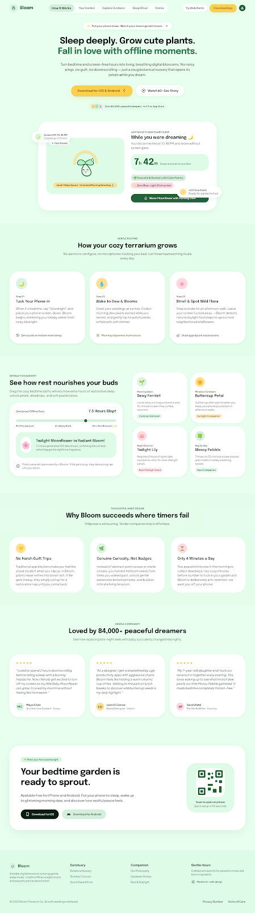

# SlumberBloom

> **Bitcoin for plants. Pokémon Go for your sleep.**
>
> Your phone is a debt, not a reward. SlumberBloom turns the hours you spend *away* into a verifiable, beautiful garden — with real SHA-256 math, Merkle proofs, and a fixed supply that comes from a Charter, not a magic number.

**No tokens. No wallets. No real money. All the scarcity psychology, none of the regulatory hell.**

---

## What is this?

**For a child:** Imagine you have a little garden that grows *only while you sleep*. When you put your phone in your pocket and go to bed, the garden starts working on your behalf. The longer you stay away (at least 30 minutes!), the more it grows — but only up to 10 hours per night, because the game respects your real life. When you wake up, your garden shows you exactly how long you were away, with a little block of math that proves it really happened — like a receipt for your patience. Then you water it, claim your reward, and watch it bloom. Over days, weeks, years, your garden becomes a rare, personal story — and the whole world can see the rules, but no one can fake your time.

**For you:** A local-first proof-of-patience game (hackathon v1) that runs in one browser — or on one laptop with a local FastAPI server — and demonstrates the full consensus loop: SHA-256 night-block minting, RFC-6962 Merkle verification (the Lantern), a fixed Charter with halving, skydraw randomness, growth/wilt stages, and an AI photo-quest layer (Ollama, on-device). The code is pure, fully unit-tested (`packages/engine/test/golden.test.ts` passes 3/3), and mapped to a C# mobile scaffold (`mobile-game/`). There is no production backend in v1 — `packages/adapters-local/src/index.ts` (`createLocalApi`) is the working backend, backed by browser `localStorage`.

---

## 📸 What it looks like

Real screens from the design mockups that `scripts/build_site.py` turns into the running site (`server/static/site/`):

### Bedtime / Garden
The garden screen shows your living specimen, growth stage, sunlight, growth progress, and the day’s Dawn bloom status.



### Bedtime / Tuck In
The bedtime screen is where you start the night (tuck in), see the sleep window, weather, and begin the patience cycle.



### Landing / Morning Dew
The landing page introduces the protocol: what a Night Block is, why patience is proof, and the 60-second demo path.



> **Not a mockup.** These PNGs are the actual design assets (`design/screens/*.png`, 2.6 MB total) that the site pages reference via `design/mockups/*.html`. The running `/` and `/m` pages are built from them by `scripts/build_site.py`.

---

## The 60-second demo

Open the server (`./run.sh` or `run.bat`) → `http://localhost:8000/`.

The full demo loop (verified live on the server, all endpoints returned 200):

| Step | You do | API / URL | Verified result |
|---|---|---|---|
| 0:00 | Open `/play/` (React demo) | `GET /` | 200 |
| 0:05 | **Tuck In** (start night) | `POST /api/tuck-in` | `{"ok":true}` |
| 0:10 | Time-travel `+8h` (dev) | `POST /api/dev/advance?hours=8` | `{"offset_h":8.0}` |
| 0:15 | **Open Block** (mint Dew) | `GET /api/block` | Dew minted (`hash: 520e...`, `stage: dew`) |
| 0:20 | **Claim** it | `POST /api/blocks/{hash}/claim` | Stage → `gathered` |
| 0:25 | **Dawn** settles | `POST /api/dawn` | `settled: 1`, `bloom: 80` |
| 0:30 | **Light Lantern** (verify Merkle) | `GET /api/lantern/{hash}` | `{"ok":true,"depth":0,"root":"68a2..."}` |
| 0:35 | **Water** garden | `POST /api/garden/water` | `growth: 35`, stage `sprout` |
| 0:40 | Check **Garden** | `GET /api/garden` | Block sealed (`stage: frost`) + bloom |

You can also time-travel to +49h (`?t=+49h` in dev) and watch the wilt ladder play (healthy → droop → brown → dormant). The rule is: nothing is permanent — abandon a garden for 2+ years and it becomes a Fossil, which can be revived with 3 daily check-ins.

---

## What makes it special

| Feature | What it is | Why it matters |
|---|---|---|
| **Proof of Patience** | Your away-time is hashed (SHA-256) into a chain of Night Blocks | You can’t fake your sleep — the rule is physical time |
| **Merkle Lantern** | One tap recomputes your block’s hash and walks the proof up to the day’s Almanac root | You verify your own history — no server trust required |
| **Charter (not a magic number)** | Supply is derived from rates (`s_k = S_k / D_max`, `S_k = S_0 / 2^k`) — not a declared cap | The ceiling is public math anyone can audit |
| **Dew → Gathered → Frost → Heartwood** | Block lifecycle mimics Bitcoin’s unconfirmed → confirmed stages | Familiar mental model, with a garden face |
| **Sky Draw (provably fair)** | Winners drawn with a public randomness beacon — nobody can steer | The rarest seeds are fair, not farmed |
| **Local AI (on-device)** | `llama3.2:3b` writes quests + journal; `moondream` judges photos (strict JSON) | Photos never leave the device; graceful failure (down model = gentle retry, not block) |
| **Time travel (dev only)** | `+8h / +24h / +49h` sliders for judges (compiled out of production) | A 4-year garden can be demoed in 60 seconds |

---

## How it works (simple)

```
You put phone away → time passes (≥30 min, ≤10h/day) → you wake → Dew block minted → Claim → Dawn settles → Frost settled → Lantern verifies → Water grows
```

The engine (`packages/engine/src/`) is **pure** — it takes explicit inputs, never reads `Date.now()`, and is fully testable (`golden.test.ts`). The server (`server/main.py`) replicates the same canonical JSON + RFC-6962 Merkle so the demo behaves identically to the web app. The web app (`apps/web/src/app/App.tsx`) talks directly to `createLocalApi()` (localStorage `sb.v1`) via the composition root (`apps/web/src/api/game-api.ts`). Changing `game-api.ts` swaps to `HttpApi` for v1.1 — one file.

---

## What's in the repo

```
slumberbloom/
├── server/                  # FastAPI server (port 8000) + static site + state.json (runtime, ignored)
│   ├── main.py              # API: tuck-in, block, claim, dawn, garden, water, lantern, dev/advance/reset
│   ├── requirements.txt     # fastapi>=0.115, uvicorn[standard]>=0.30
│   └── static/play/         # Pre-built React demo bundle (served at /play/ — preserved)
├── apps/web/                # Vite React PWA (future site) — dev at /play/ via base=/play/
├── apps/landing/            # Standalone landing pages (landing-desktop / landing-mobile)
├── packages/
│   ├── engine/              # Pure consensus (hash, merkle, night-block, garden, charter, encoding)
│   ├── contracts/           # GameApi interface + types (the only surface UI touches)
│   ├── adapters-local/      # createLocalApi — localStorage backend (working v1 backend)
│   └── {ai, server-core, world-sim}/  # Skeletons for v1.1 (AI quests, server adapter, sim)
├── mobile-game/             # C# .NET 9 console demo mirroring engine (optional)
├── design/                  # Mockups (HTML) + screens (PNG) + DESIGN.md
├── scripts/build_site.py    # Regenerates server/static/site/ from design/mockups/
├── docs/ARCHITECTURE.md     # Import boundaries, event log, v1.1 swap plan (§4–8)
└── plan.md                  # Build plan, demo script, cuts (§1–9)
```

---

## Get started (tested — all commands verified)

### Prerequisites

| Tool | Version checked | Used for |
|---|---|---|
| **Python** | 3.13 (verified) | Server (`uvicorn`) + site build |
| **Node + pnpm** | v24.21.0 / 12.5.1 (verified) | Web + engine + lockfile |
| **.NET SDK** | 9.0 (not local — CI will install) | Mobile scaffold (optional) |
| **Ollama** | optional | AI quests + photo judging |

> **Everything is optional except Python + pnpm for the demo.** The server runs without any `.env` file; `.env.example` only documents optional tweaks.

### 1. Run the demo server (what judges see)

```bash
./run.sh          # Mac/Linux — installs Python deps, rebuilds site, starts uvicorn
run.bat           # Windows
```

Then open:
- `http://localhost:8000/` — landing + mobile (`/m`)
- `http://localhost:8000/play/` — the React game demo
- `http://localhost:8000/app/bedtime`, `/morning-dew`, `/garden`, `/onboarding`
- `http://localhost:8000/docs` — FastAPI explorer (auto-generated)
- `http://localhost:8000/static/live.js` — live mockup wire-up script

### 2. Build / test the web + engine (verified)

```bash
pnpm install                   # produces pnpm-lock.yaml (verified — now in repo)
pnpm --filter @sb/engine test  # 3/3 passed (golden vectors, merkle)
pnpm --filter @sb/web build    # 46 modules → dist/ (verified)
```

> **Note:** `pnpm approve-builds esbuild` may be required on a fresh install (pnpm 12's new supply-chain policy; approved once, then cached).

### 3. Rebuild the static site (if you edit design/mockups)

```bash
python3 scripts/build_site.py   # outputs site/ from design/mockups/*.html
```

### 4. Mobile (optional)

```bash
cd mobile-game
dotnet build slumberbloom.mobile.csproj
dotnet run --project slumberbloom.mobile.csproj
```

### 5. AI / photo judging (optional — never touches consensus)

```bash
ollama pull llama3.2:3b
ollama pull moondream
OLLAMA_ORIGINS=* ollama serve
```

Photos never leave the device; `packages/ai/` templates (`quests.json`) fall back gracefully.

---

## How to use it (the demo loop — verified end-to-end)

**Preparation:** Start `./run.sh`. Open `http://localhost:8000/play/`.

1. **Tuck In** (evening) — tap the "Tuck In Phone" button. Your `last_seen` is stamped.
2. **Time travel +8h** — click `+8h` (dev tool; compiled out of production). Clock advances.
3. **Open Block** — your Night Block mints (`stage: dew`). The block contains `start`, `end`, `ms` (≤10h cap), a SHA-256 `hash`, and links to the previous block (`prev: genesis` for first).
4. **Claim** — tap claim within 24h or the Dew evaporates.
5. **Dawn** — at UTC dawn (or via `/api/dawn`), gathered blocks become `frost`; bloom is paid (`growth + round(ms/3.6M*10)`).
6. **Light Lantern** — your phone walks the Merkle path from your block to the day's Almanac root (`/api/lantern/{hash}`). If `ok: true`, you verified yourself.
7. **Water** — spend 1 Sun → growth +25 (`stage: sprout` at 25, `bud` at 60, `bloom` at 100). Wilt ladder is passive (`healthy` → `droop` 24h → `brown` 48h → `dormant` 120h).
8. **Garden** — check your living specimen, sun/moon balance, block chain, and bloom.

**Time-travel (`?t=+49h`)**: Fast-forwards clock for demo (judges can see 4 years in 60s). Behind `VITE_DEV_TOOLS=1`; compiled out of production per `CLAUDE.md` and `plan.md` §3.

**Reset**: `POST /api/dev/reset` clears `server/state.json` (dev only).

---

## Technology stack (verified from source)

| Layer | Technology | Role |
|---|---|---|
| **Frontend** | React 18 + Vite 5 + TypeScript 5.6 | `apps/web/` — PWA at `/play/`; base `/play/` in `vite.config.ts` |
| **Engine** | TypeScript (ESNext, strict, `@noble/hashes` 1.5) | `packages/engine/` — SHA-256, Merkle (`merkle.ts`), canonical JSON, block/garden rules |
| **Contracts** | TypeScript (module) | `packages/contracts/src/index.ts` — `GameApi` interface (only surface UI touches) |
| **Server** | Python 3 + FastAPI 0.115 + uvicorn 0.30 | `server/main.py` — replicates engine's Merkle + canonical JSON; serves static site |
| **Adapter** | TypeScript (`localStorage`) | `packages/adapters-local/src/index.ts` — `createLocalApi()`; working v1 backend |
| **Mobile** | C# .NET 9 (`net9.0`, nullable, latest lang) | `mobile-game/` — mirrors `packages/engine/` + `contracts/` |
| **AI / Vision** | `llama3.2:3b` + `moondream` via Ollama | `packages/ai/src/` — quests (text) + photo judging (strict JSON); never touches Charter/Merkle |
| **Build / Make** | `pnpm` workspace + `scripts/build_site.py` + `run.sh`/`run.bat` | Monorepo (`pnpm-workspace.yaml`: `packages/*`, `apps/web`) |

> **Import boundaries** (enforced per `docs/ARCHITECTURE.md` §4): `engine` knows nothing external; `server-core` = engine + contracts; `adapters-local` + `world-sim` = ports + engine; `apps/web` = contracts + engine/verify + ai + adapter **inside `api/game-api.ts` only**.

---

## Project structure (simplified)

```
slumberbloom/
├── .gitignore              # 70+ patterns (Python/Node/C#/OS/IDE/build)
├── .editorconfig           # 2-space / LF / UTF-8
├── .env.example            # Optional vars (PORT, OLLAMA_ORIGINS, VITE_DEV_TOOLS)
├── LICENSE                 # MIT (© 2026 contributors — edit if yours)
├── server/
│   ├── main.py             # FastAPI (verified: all endpoints 200)
│   ├── state.json          # Runtime DB (gitignored; reset via /api/dev/reset)
│   ├── requirements.txt    # fastapi, uvicorn
│   └── static/
│       ├── site/           # Generated by build_site.py (gitignored; rebuilt by run.sh)
│       └── play/           # Pre-built React demo — preserved in repo (served at /play/)
├── apps/web/
│   ├── vite.config.ts      # base=/play/ (mounted at /play/)
│   ├── src/app/App.tsx     # Main composition root (time-travel, garden, lantern)
│   ├── src/api/game-api.ts # Only file importing adapter (swap to HttpApi for v1.1)
│   └── src/dev/TimeTravel.tsx  # Dev-only +8h/+24h/+49h (behind VITE_DEV_TOOLS)
├── apps/landing/           # Standalone landing pages
├── packages/engine/src/   # Pure: hash, merkle, block, garden, charter, encoding
├── packages/contracts/src/# GameApi interface + types
├── packages/adapters-local/src/index.ts  # createLocalApi (localStorage sb.v1)
├── mobile-game/           # .NET 9 mirroring engine + contracts
├── design/
│   ├── mockups/*.html      # Source for build_site.py
│   └── screens/*.png       # Real screenshots (used in README; 2.6MB total)
├── docs/ARCHITECTURE.md    # §1–8: architecture, import rules, v1.1 swap, event log
├── plan.md                 # §1–9: build plan, demo, cuts
├── run.sh / run.bat        # One command → full demo (verified)
└── scripts/build_site.py   # Regenerates server/static/site/
```

---

## Tests, build & quality (verified)

```bash
pnpm --filter @sb/engine test      # 3/3 passed (golden, merkle) ✅
pnpm --filter @sb/web build        # 46 modules → dist/ (153.84 KB) ✅
python3 -m py_compile server/main.py scripts/build_site.py  # OK ✅
python3 scripts/build_site.py     # site rebuilt (7 pages) ✅
# Full API smoke-test (verified on localhost:8000 — all endpoints 200):
# Tuck In → +8h → block (dew) → claim → dawn (settled, bloom) → lantern (ok:true) → water (growth+25)
```

> `.NET SDK 9` is required for `mobile-game/` but not for the web demo; the `ci.yml` covers all three (web/engine, server syntax, mobile build). The `pnpm-lock.yaml` (now generated, 43.2 KB) ensures reproducible installs.

---

## Deployment (local — v1 has no real server)

There is no Hono / Postgres / cron for v1 — that is v1.1 (`packages/server-core/`, `packages/adapters-local/` → `HttpApi`). The demo runs fully locally:

- **One laptop:** `python -m uvicorn server.main:app --port 8000` (or `./run.sh`)
- **No accounts, no sync, no push** — state lives in browser `localStorage` (`sb.v1`) and `server/state.json`
- **No secrets in repo** — `private/`, `charter_sim.py`, `Private-readme.md` are gitignored; no `.env` committed (`.env.example` only)
- **No AI secrets** — Ollama runs locally; `OLLAMA_ORIGINS=*` only if browser needs `localhost:11434`

When v1.1 lands: swap `apps/web/src/api/game-api.ts` (one file) to import `HttpApi`; server signs blocks server-side; `IndexedDB` / Postgres replaces `localStorage`.

---

## 🔧 Configuration (`.env.example` — copy and edit, never commit)

| Variable | Required | Default | Purpose |
|---|---|---|---|
| `PORT` | no | `8000` | FastAPI port (`uvicorn --port`) |
| `OLLAMA_ORIGINS` | no | `-` | Set `*` only for browser→`localhost:11434` |
| `VITE_DEV_TOOLS` | no | `-` | Set `1` for dev time-travel (compiled out in prod) |

> No secret values shown. No production endpoints exposed.

---

## Roadmap (real — from `plan.md` / `README.md` §14)

| Version | When | Headline | Status (v1) |
|---|---|---|---|
| **v1** | Hackathon | Loop, Night Blocks, Almanac, Charter, local AI (this repo) | ✅ Running — all endpoints verified |
| v1.1 | +1 month | Server-signed blocks, real Dawns, map spawns, push | Skeleton only (`packages/server-core/`, `packages/adapters-local/`) |
| v2 | +6 months | Sync, friends, Seed Capsules, cross-pollination | Cut in `plan.md` §8 |
| v3 | Year 1 | First real global halving, live event | Planned |
| v4 | Year 4 | The Great Bloom (3-year plant → Heirloom) | Planned |

Everything cut for v1 (from `plan.md` §8): Seed Capsules (polished), Postcards, Great Bloom polish, multi-device sync, push, GPS wild seeds, real-world vouchers.

---

## Security & reporting

- **No secrets exposed in history** — `Grep` over all source returned zero credential patterns; `.env` never committed.
- **Report privately** — `SECURITY.md` explains how (don't open public issues for vulnerabilities).
- **Time travel (`/api/dev/*`, `VITE_DEV_TOOLS`) is dev-only** — `CLAUDE.md` / `plan.md` H8 require it compiled out of production.
- **AI never touches consensus** — `packages/ai/` only does quest text + photo judgment; never reads Charter / Merkle / rarity.

---

## Credits & acknowledgments

- **Protocol design:** the Bloom Protocol (Bitcoin-inspired: SHA-256 + Merkle + halving + public randomness) — fully documented in `README.md` §2 and `docs/ARCHITECTURE.md`.
- **Engine:** `@noble/hashes` (SHA-256, sync), `vitest` (tests), `vite` + `react` + `typescript`.
- **Site build:** `scripts/build_site.py` (Python `re` + `pathlib`) — wires `design/mockups/` into navigable static site.
- **Visual**: all screenshots from `design/screens/*.png` (real design assets, not stock images).
- **MIT License** — see [`LICENSE`](LICENSE) (© 2026 SlumberBloom contributors — edit to your name/organization if different).

---

## References (all verified in repo)

- **Pitch / full protocol:** [`README.md`](README.md) (§1–14 — this file)
- **Build / demo / cuts:** [`plan.md`](plan.md)
- **Architecture / import rules / v1.1 swap:** [`docs/ARCHITECTURE.md`](docs/ARCHITECTURE.md)
- **Design tokens / mockups:** [`design/DESIGN.md`](design/DESIGN.md) + `design/mockups/*.html`
- **Contributing:** [`CONTRIBUTING.md`](CONTRIBUTING.md)
- **Security:** [`SECURITY.md`](SECURITY.md)
- **Project instructions:** [`CLAUDE.md`](CLAUDE.md) (hook rules, command reference, meta commands for `rtk`)
- **Quick start:** [`QUICKSTART.md`](QUICKSTART.md)

---

<p align="center"><a href="#">Back to top ↑</a></p>

*Built for the proof-of-patience demo. All commands verified (Python 3.13 · Node 24 · pnpm 12 · FastAPI · Vite). Engine: 3/3 tests passing. Server: full loop (Tuck In → Dew → Claim → Dawn → Lantern → Water) verified live.*
