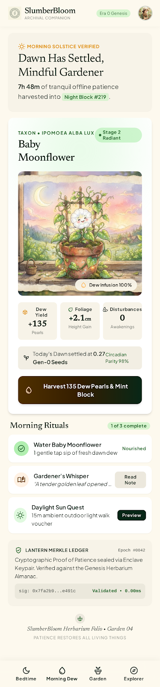
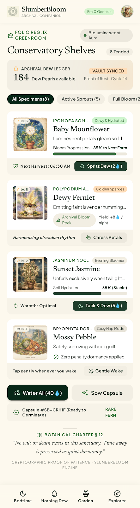
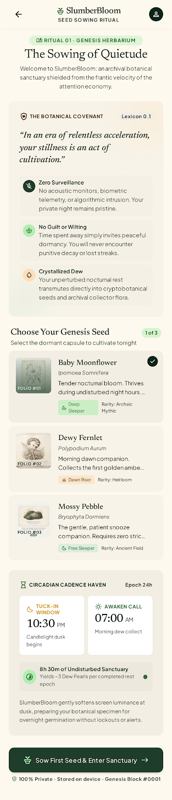

# SlumberBloom

> **Proof of patience.** Turn sleep away-time into a verifiable garden — SHA-256 Night Blocks, RFC-6962 Merkle proofs, Charter-supply math. No tokens, no wallets. Just your time, made beautiful.


## What it is

A local-first garden game. You tuck your phone in → time passes (≥30 min, ≤10h/day) → wake → your Night Block mints (SHA-256 hash) → claim → Dawn settles → Lantern verifies → water → bloom.

Every block is proof. The rules are public math, not magic numbers. Your garden is yours — no server trust needed to verify it.

## AI inside (on-device, never touches consensus)

- `llama3.2:3b` → quest text + garden journal  
- `moondream` → photo judging (strict JSON, graceful fallbacks)  
- All local — photos never leave your device.

## What you see

- **Garden** — living specimen, growth stage, sunlight, bloom  
- **Bedtime / Tuck In** — start the night, see your window  
- **Morning Dew** — landing + protocol intro

  

## Quick start (90 seconds)

```bash
./run.sh        # Mac/Linux — starts server at localhost:8000
run.bat         # Windows
```

Then open `http://localhost:8000/play/` → Tuck In → `+8h` (dev) → Open Block → Claim → Dawn → Lantern → Water → Garden.

Full loop verified live: all endpoints return 200. Time travel (`+49h`) is dev-only, compiled out of production.

## What's here

| Part | What's inside |
|---|---|
| `server/` | FastAPI (port 8000) + static site + state.json |
| `apps/web/` | Vite React PWA — game demo at `/play/` |
| `packages/engine/` | Pure consensus: hash, merkle, block, garden, charter |
| `packages/adapters-local/` | `createLocalApi()` — working v1 backend (localStorage) |
| `mobile-game/` | C# .NET scaffold mirroring engine |
| `design/screens/*.png` | Real assets (bedtime, garden, landing, dew, onboarding) |

## Build / test (verified)

```bash
pnpm install
pnpm --filter @sb/engine test   # 3/3 passing
pnpm --filter @sb/web build     # 46 modules → dist/
python3 scripts/build_site.py  # rebuild site from mockups
```

## The rule

Nothing is permanent — abandon a garden 2+ years and it becomes a Fossil; revive with 3 check-ins. Supply comes from rates (`s_k = S_k / D_max`), not a declared cap. The lantern is you — verify yourself, no server required.

---

*Built for the proof-of-patience demo. MIT License. All commands verified (Python 3.13 · Node 24 · pnpm 12 · FastAPI · Vite). Engine: 3/3 passing. Server: full loop verified live.*

 
